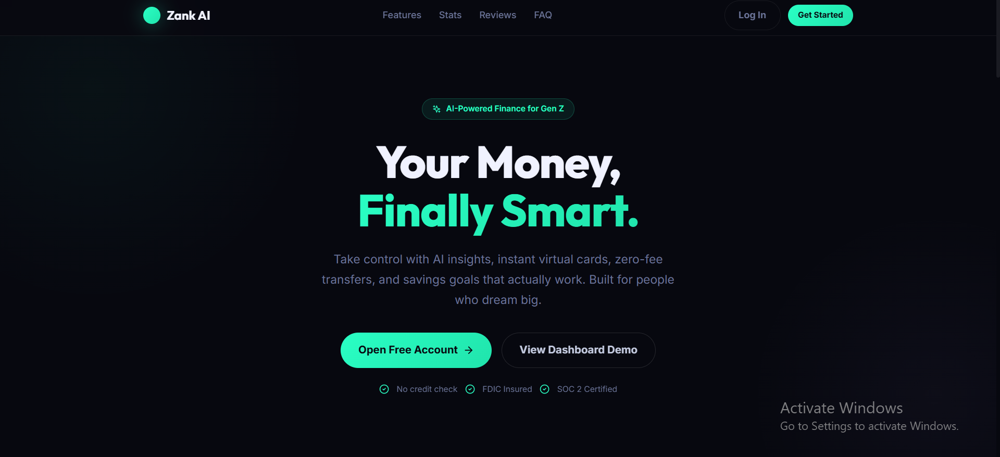
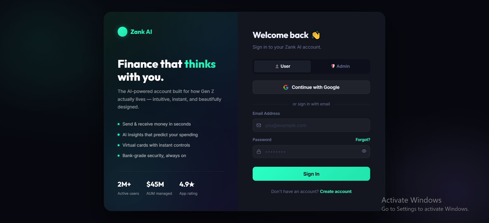
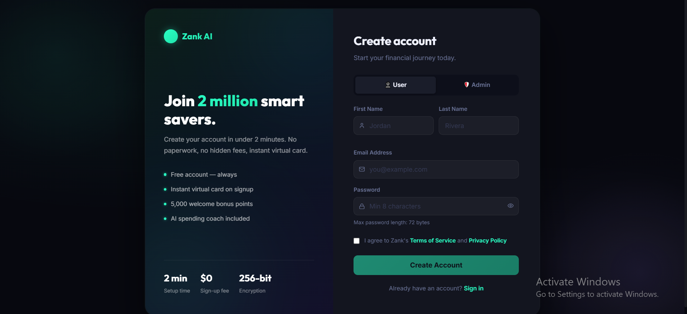

<h1 align="center">🏦 Zank AI</h1>

<p align="center">
  <b>A full-stack AI fintech dashboard prototype with digital wallet, virtual cards, transactions, savings goals, budgets, analytics, rewards, security/KYC screens, OTP authentication, and admin operations dashboard.</b>
</p>

<p align="center">
  
  
  
  
  
  
  
  
  
  
</p>

<p align="center">
  <b>Digital Wallet</b> •
  <b>Virtual Cards</b> •
  <b>Transactions</b> •
  <b>Analytics</b> •
  <b>Savings Goals</b> •
  <b>Budgets</b> •
  <b>Admin Ops</b>
</p>

---

## 📸 Project Screenshots

Homepage




| Login | Register |
|---|---|
|  |  |


---

## 🚀 Project Overview

**Zank AI** is a full-stack fintech dashboard prototype built with **FastAPI**, **SQLAlchemy**, **Next.js 14**, **React 18**, and modern dashboard UI components.

The project includes a public fintech landing page, authentication flow, user dashboard, wallet management, virtual card management, transaction history, savings goals, monthly budgets, analytics, rewards, security/KYC screens, user settings, support pages, and an internal admin operations dashboard.

The backend exposes REST APIs through FastAPI under `/api/v1`, uses SQLAlchemy models for persistent user, wallet, card, transaction, OTP, refresh token, and password reset records, and supports local SQLite development as well as PostgreSQL through Docker Compose.

The frontend is a polished Next.js application with route-based user and admin dashboards, responsive sidebar navigation, reusable service files, API client interceptors, animated UI sections, Tailwind configuration, Lucide icons, Framer Motion, and Recharts support.

> **Important:** This is a **portfolio/demo fintech application**, not a real banking product. It does not connect to real banks, card issuers, payment processors, KYC vendors, or production financial infrastructure.

---

## 🎯 Project Purpose

Modern fintech platforms need more than a simple balance screen. A practical digital finance dashboard should include onboarding, authentication, wallets, cards, transaction tracking, savings goals, budget planning, spending analytics, security settings, support tools, and admin-level operational visibility.

**Zank AI** demonstrates these ideas in a learning-friendly full-stack project. It combines a polished fintech user interface with a FastAPI backend that handles authentication, wallets, cards, transactions, user profiles, and admin-protected endpoints.

This project is suitable for portfolio practice because it demonstrates:

- Full-stack project structure
- REST API integration
- JWT authentication
- Frontend route organization
- Dashboard UI development
- Local database persistence
- Docker-based development option
- Role-based user/admin separation
- Realistic fintech-style workflows

---

## 🎯 Key Highlights

- 🏦 AI-style fintech dashboard prototype
- 🌐 Public landing page for fintech product presentation
- 🔐 Email verification, OTP login, JWT access tokens, and refresh token cookie flow
- 👤 User registration, login, profile, avatar, linked accounts, and notification preferences
- 💳 Digital wallet with balance, available balance, held balance, wallet ID, account number, and routing number
- 💸 Send money, request money, withdraw flow, and withdrawal OTP endpoint
- 💳 Virtual card creation, card status, limits, controls, card details, and OTP-protected card details flow
- 📊 Transaction listing, filters, stats, details, and export endpoint
- 🎯 Savings goals with contributions and wallet balance deduction
- 🧾 Monthly budgets with category limits and budget adherence calculation
- 📈 Analytics endpoints for spending, top categories, health score, and overview metrics
- 🎁 Rewards, offers, redemption, and rewards history demo endpoints
- 🛡️ Security/KYC screens, login history, sessions, and settings demo endpoints
- 🧑‍💼 Admin dashboard with users, wallets, transactions, reconciliation, risk, compliance, audit logs, support, and platform settings screens
- 🐳 Docker Compose setup with frontend, backend, PostgreSQL, and Redis services
- 🗄️ SQLite fallback for quick local development without PostgreSQL
- 🎨 Modern dark fintech UI with responsive dashboard navigation
- 🧪 Swagger API documentation available through FastAPI

---

## ✨ Features

### 🌐 Public Website Features

| Feature | Description |
|---|---|
| Landing Page | Modern fintech landing page for Zank AI branding and product messaging |
| Hero Section | Dashboard preview, product tagline, badges, and call-to-action buttons |
| Product Highlights | Marketing sections for wallet, cards, spending insights, security, and rewards |
| Responsive Design | Landing page layout adjusts for desktop and smaller screen sizes |
| Authentication Links | Public navigation links users to login and registration pages |
| Polished UI | Custom CSS, gradients, glassmorphism, icon usage, and reveal effects |

---

### 🔐 Authentication Features

| Feature | Description |
|---|---|
| User Registration | Registers a user or admin role through the frontend registration form |
| Pending Registration | Stores pending users until email verification is completed |
| Email Verification | Sends verification link with 24-hour token validity |
| Login | Validates email and password using hashed password checks |
| OTP Login | Sends a 6-digit login OTP with 10-minute expiry |
| JWT Access Token | Issues short-lived JWT access token after OTP verification |
| Refresh Token | Stores refresh token in database and sends it as an HTTP-only cookie |
| Logout | Deletes refresh token record and clears refresh cookie |
| Forgot Password | Generates password reset token and sends reset email |
| Reset Password | Validates reset token and updates hashed password |
| Google Login | Includes Google OAuth flow with local mock fallback for development |
| Bcrypt Password Hashing | Uses Passlib bcrypt hashing with 72-byte password validation |

---

### 👤 User Dashboard Features

| Feature | Description |
|---|---|
| User Overview | Shows wallet balance, quick actions, recent wallet activity, analytics overview, savings summary, budget summary, and security snapshot |
| Wallet Page | Displays wallet balances, wallet identity, account details, linked accounts, and wallet actions |
| Cards Page | Shows user virtual cards, card limits, card status, controls, and card detail actions |
| Transactions Page | Displays transaction history with status, type, category, date, amount, and export support |
| Analytics Page | Shows spending overview, income, expenses, net amount, categories, and financial health metrics |
| Savings Goals | Allows users to create, update, contribute to, and delete savings goals |
| Budgets | Lets users set category-based monthly budget limits and track spending progress |
| Rewards | Displays loyalty tier, points, cashback, offers, and redemption actions |
| Security & KYC | Displays KYC status, security settings, sessions, and login history screens |
| Settings | Supports profile settings, notification preferences, and linked accounts UI |
| Support | Provides user support page layout for fintech help workflows |

---

### 💳 Wallet & Money Movement Features

| Feature | Description |
|---|---|
| Wallet Creation | A starter wallet is created automatically after verified registration |
| Balance Tracking | Wallet stores total balance, available balance, held balance, and currency |
| Wallet Identity | Stores wallet ID, account number, and routing number |
| Send Money | Creates debit transaction for sender and credit transaction for receiver |
| Request Money | Provides request-money endpoint for frontend workflow |
| Withdraw OTP | Sends withdrawal OTP before withdrawal request |
| Withdraw Funds | Deducts wallet balance and records withdrawal transaction |
| Transaction Records | Wallet operations create transaction records where implemented |
| Linked Accounts | Users can add or remove linked account records in development storage |

---

### 💳 Virtual Card Features

| Feature | Description |
|---|---|
| Card Listing | Lists cards belonging to authenticated user |
| Create Card | Creates a virtual card with generated last four digits and expiry |
| Card Status | Supports active/frozen card status update |
| Card Limits | Updates daily and monthly card limits |
| Card Controls | Stores allowed categories and blocked merchants in card metadata |
| OTP-Protected Details | Sends OTP before showing sensitive card detail payload |
| Delete Card | Allows users to remove a virtual card |
| Local Demo Cards | Card numbers and sensitive details are generated for demo/testing only |

---

### 📊 Transactions & Analytics Features

| Feature | Description |
|---|---|
| Transaction List | Supports pagination, type filter, status filter, date filter, and search |
| Transaction Stats | Calculates income, expenses, net value, and chart data by period |
| Transaction Details | Returns a single transaction by transaction reference |
| Export Endpoint | Exports transaction rows using CSV-style output for CSV/PDF/XLSX requests |
| Spending Analytics | Calculates income, expenses, top spending categories, and chart points |
| Health Score | Calculates financial health score from savings, budget adherence, activity, and balance |
| Budget Comparison | Compares budget limits against actual category spending |
| Overview Analytics | Returns dashboard summary metrics for user overview cards |

---

### 🎯 Savings & Budget Features

| Feature | Description |
|---|---|
| Savings Goals | Users can create savings goals with target amount, deadline, and icon |
| Contributions | Contributions deduct from available wallet balance and increase goal progress |
| Goal Progress | Progress percentage is calculated from current amount and target amount |
| Goal Refund | Deleting a goal returns saved amount to wallet balance |
| Budget Categories | Default categories include groceries, fuel, entertainment, dining, shopping, bills, and travel |
| Monthly Budgets | Budget records are grouped by month and year |
| Budget Status | Categories can show on-track, warning, or over-budget status |
| Adherence Score | Budget summary calculates spending adherence percentage |

---

### 🛡️ Security, KYC & Rewards Features

| Feature | Description |
|---|---|
| KYC Status | Returns KYC status and completion progress for frontend display |
| KYC Upload | Demo endpoint for KYC document upload action |
| Security Settings | Provides 2FA, biometric, login notification, and session timeout settings |
| Sessions | Returns active session list placeholder |
| Login History | Returns login history placeholder |
| Rewards Summary | Returns loyalty tier, reward points, cashback, streak, and next-tier progress |
| Offers | Includes demo offer listing and activation endpoints |
| Points Redemption | Includes reward redemption endpoint returning credited amount |

---

### 🧑‍💼 Admin Panel Features

| Feature | Description |
|---|---|
| Admin Overview | Displays platform KPIs such as users, AUM, daily volume, risk flags, KYC queue, revenue, and tickets |
| Manage Users | Admin UI for user account status, KYC, risk, balance, and account operations |
| Platform Wallets | Admin screen for wallet overview and platform wallet monitoring |
| All Transactions | Admin view for platform-wide transaction monitoring |
| Reconciliation | Admin screen for reconciliation alerts and operational checks |
| Risk Intelligence | Admin risk-monitoring screen using mock risk data |
| Compliance & KYC | Admin compliance screen for KYC review workflow |
| Audit Logs | Admin audit log screen for system activity |
| User Support | Admin support screen for user tickets and responses |
| Platform Settings | Admin settings page for internal platform configuration |
| Admin API Guard | Backend admin endpoints require authenticated user role equal to `admin` |

> Some admin dashboard data is currently mock/static frontend data or demo backend data. It is useful for UI and workflow practice but should not be presented as production financial data.

---

## 🧑‍💼 User Roles

| Role | Access Level |
|---|---|
| 👤 User | User dashboard, wallet, cards, transactions, savings, budgets, analytics, rewards, security, settings, and support |
| 🛡️ Admin | Admin dashboard, users, platform wallets, all transactions, reconciliation, risk, compliance, audit logs, support, and platform settings |

> The registration page includes a role toggle. For a production system, admin creation should be restricted and controlled by a secure back-office process.

---

## 🛠 Tech Stack

| Layer | Technologies |
|---|---|
| Backend | FastAPI, Python 3.11, Uvicorn |
| API Documentation | FastAPI Swagger UI and OpenAPI |
| Database ORM | SQLAlchemy |
| Local Database | SQLite fallback through `sqlite:///./zank_dev.db` |
| Docker Database | PostgreSQL 15 Alpine |
| Cache / Future Queue | Redis 7 Alpine through Docker Compose |
| Authentication | JWT access tokens, refresh token cookie, OTP login |
| Password Hashing | Passlib bcrypt |
| Email | Python SMTP utilities |
| Google Auth | Google OAuth helper with local mock fallback |
| Frontend | Next.js 14.0.4, React 18.2.0 |
| Frontend Language | JavaScript, JSX, TypeScript config with `allowJs` |
| Styling | Tailwind CSS, custom CSS, dashboard CSS |
| UI / Icons | Lucide React, Framer Motion, Recharts |
| API Client | Axios with token refresh interceptor |
| Package Management | pip, npm |
| Containerization | Docker, Docker Compose |

---

## 🏗 Architecture Overview

The project follows a separated frontend/backend architecture. The FastAPI backend exposes REST endpoints, handles authentication and data persistence, while the Next.js frontend consumes those APIs and renders user/admin dashboards.

```text
Zank-AI/
├── docker-compose.yml
├── backend/
│   ├── Dockerfile
│   ├── requirements.txt
│   └── app/
│       ├── main.py
│       ├── core/
│       │   ├── database.py
│       │   ├── dependencies.py
│       │   ├── email_utils.py
│       │   └── security.py
│       ├── models/
│       │   └── __init__.py
│       ├── routers/
│       │   ├── auth.py
│       │   ├── users.py
│       │   ├── wallet.py
│       │   ├── cards.py
│       │   ├── transactions.py
│       │   ├── savings.py
│       │   ├── budgets.py
│       │   ├── analytics.py
│       │   ├── rewards.py
│       │   ├── security.py
│       │   ├── admin.py
│       │   └── dashboard_state.py
│       └── schemas/
│           └── __init__.py
│
├── frontend/
│   ├── Dockerfile
│   ├── package.json
│   ├── next.config.mjs
│   ├── tsconfig.json
│   ├── app/
│   │   ├── page.tsx
│   │   ├── layout.tsx
│   │   ├── admin/
│   │   ├── user/
│   │   └── auth/
│   ├── components/
│   │   ├── lib/
│   │   ├── providers/
│   │   └── pages/
│   │       ├── auth/
│   │       ├── dashboard/
│   │       └── admin/
│   ├── src/
│   │   ├── context/
│   │   ├── services/
│   │   └── utils/
│   ├── styles/
│   └── public/
│
├── docs/
│   └── screenshots/
├── README.md
└── LICENSE
```

---

## 🔄 Application Flow

### Visitor / Landing Flow

```text
Visit Homepage
        ↓
Read fintech product sections
        ↓
Click Login or Register
        ↓
Create account or sign in
        ↓
Continue to user dashboard
```

### Registration & Verification Flow

```text
Register User/Admin
        ↓
Backend stores pending registration
        ↓
Verification email is generated
        ↓
User opens verification link
        ↓
Backend creates user account
        ↓
Starter wallet is created
        ↓
User can login
```

### Login & OTP Flow

```text
Enter Email and Password
        ↓
Backend validates credentials
        ↓
OTP is generated and emailed
        ↓
User submits OTP
        ↓
Backend issues JWT access token
        ↓
Refresh token is stored as HTTP-only cookie
        ↓
Frontend redirects by user role
```

### User Finance Flow

```text
Login as User
        ↓
Open User Dashboard
        ↓
View Wallet, Cards, Transactions, Analytics
        ↓
Send / Request / Withdraw Money
        ↓
Create Savings Goals and Budgets
        ↓
Review Rewards and Security Settings
```

### Virtual Card Flow

```text
Open Cards Page
        ↓
Create Virtual Card
        ↓
Set Status, Limits, and Controls
        ↓
Request OTP for Card Details
        ↓
View Demo Card Details
```

### Savings Goal Flow

```text
Create Savings Goal
        ↓
Set Target Amount and Deadline
        ↓
Contribute From Wallet Balance
        ↓
Track Goal Progress
        ↓
Delete Goal to Refund Saved Amount
```

### Admin Operations Flow

```text
Login as Admin
        ↓
Open Admin Dashboard
        ↓
Review Platform KPIs
        ↓
Check Users, Wallets, Transactions
        ↓
Review Risk, Compliance, Reconciliation, Audit Logs
        ↓
Manage Support and Settings
```

---

## 🗄 Database Overview

The backend uses SQLAlchemy models. For local development, the app creates SQLite tables automatically on startup. With Docker Compose, PostgreSQL is configured for backend persistence.

### Main Data Tables

| Table | Purpose |
|---|---|
| `users` | Stores user/admin accounts, profile details, role, KYC status, loyalty tier, avatar, active status, and verification status |
| `pending_registrations` | Stores unverified registration records and email verification tokens |
| `password_reset_tokens` | Stores password reset token records, expiry, and used status |
| `refresh_tokens` | Stores refresh tokens for authenticated sessions |
| `otp_codes` | Stores login OTP codes with expiry and used status |
| `wallets` | Stores wallet ID, balances, currency, account number, and routing number |
| `cards` | Stores virtual card name, last four digits, expiry, status, limit, color, and type |
| `transactions` | Stores transaction reference, merchant, type, amount, currency, category, status, note, and timestamp |

### Development In-Memory Stores

| Store | Purpose |
|---|---|
| `SAVINGS_STORE` | Stores savings goals during runtime |
| `BUDGET_STORE` | Stores monthly budget categories during runtime |
| `USER_NOTIFICATION_PREFS` | Stores user notification preferences during runtime |
| `USER_LINKED_ACCOUNTS` | Stores linked bank accounts during runtime |
| `CARD_META` | Stores card controls and card metadata during runtime |

> In-memory stores reset when the backend restarts. Move these to database tables before using the project as a production-style application.

---

## 🔐 Security Implementations

| Security Area | Implementation |
|---|---|
| Password Hashing | Uses Passlib bcrypt with password length validation |
| Access Token | JWT access token generated after OTP verification |
| Refresh Token | Stored in database and sent through HTTP-only cookie |
| OTP Verification | Login requires OTP verification before receiving access token |
| Email Verification | New accounts are stored as pending registrations until verification |
| Password Reset | Password reset tokens expire and can be marked as used |
| Admin Guard | Admin routes use `get_current_admin` role check |
| CORS | Backend allows local frontend origins and deployed frontend origin |
| Protected APIs | User wallet, cards, transactions, savings, budgets, analytics, and profile APIs require Bearer token |
| Cookie Settings | Refresh token uses HTTP-only cookie in local development |

> Recommended production improvements: change the default JWT secret, use HTTPS-only secure cookies, restrict admin registration, move secrets to environment variables, add rate limiting, add CSRF strategy where needed, use real email provider, add audit logs, validate uploads, and implement database-backed KYC/security workflows.

---

## 📡 API Routes / System Areas

| Area | Endpoint Prefix | Purpose |
|---|---|---|
| Health | `/health` | Backend health check |
| Swagger | `/docs` | FastAPI Swagger API documentation |
| Auth | `/api/v1/auth` | Register, verify email, login, OTP, refresh token, logout, forgot password, reset password, Google auth |
| Users | `/api/v1/user` | Profile, avatar, notification preferences, linked accounts |
| Wallet | `/api/v1/wallet` | Wallet summary, send money, request money, withdraw OTP, withdraw funds |
| Cards | `/api/v1/cards` | Card list, create card, card details OTP, card details, status, limits, controls, delete card |
| Transactions | `/api/v1/transactions` | Transaction list, stats, export, and transaction details |
| Savings | `/api/v1/savings` | Savings goals, create goal, contribute, update, delete |
| Budgets | `/api/v1/budgets` | Get and update monthly budget categories |
| Analytics | `/api/v1/analytics` | Spending analytics, health score, analytics overview |
| Rewards | `/api/v1/rewards` | Rewards summary, offers, activate offer, history, redeem |
| Security | `/api/v1/security` | KYC, security settings, sessions, login history |
| Admin | `/api/v1/admin` | Admin overview, users, and balance adjustment demo endpoint |

---

## 🧭 Frontend Routes / Pages

| Route | Purpose |
|---|---|
| `/` | Public landing page |
| `/auth/login` | Login form |
| `/auth/register` | Registration form |
| `/auth/otp` | OTP verification page |
| `/auth/verify-email` | Email verification page |
| `/auth/forgot-password` | Forgot password page |
| `/auth/reset-password` | Reset password page |
| `/auth/google/callback` | Google login callback page |
| `/user` | User dashboard overview |
| `/user/wallet` | User wallet page |
| `/user/cards` | User virtual cards page |
| `/user/transactions` | User transaction history |
| `/user/analytics` | User analytics dashboard |
| `/user/savings-goals` | User savings goals |
| `/user/budgets` | User budget management |
| `/user/rewards` | User rewards page |
| `/user/security-kyc` | User security and KYC page |
| `/user/settings` | User settings |
| `/user/support` | User support |
| `/admin` | Admin platform overview |
| `/admin/manage-users` | Admin user management screen |
| `/admin/platform-wallets` | Admin platform wallets screen |
| `/admin/all-transactions` | Admin transactions screen |
| `/admin/reconciliation` | Admin reconciliation screen |
| `/admin/risk-intelligence` | Admin risk screen |
| `/admin/compliance-kyc` | Admin compliance/KYC screen |
| `/admin/audit-logs` | Admin audit logs screen |
| `/admin/user-support` | Admin support screen |
| `/admin/settings` | Admin settings screen |

---

## ⚙️ Installation Guide

### Requirements

- Python 3.11
- Anaconda / Miniconda
- Node.js 20 recommended
- npm
- Git
- Optional: Docker Desktop
- Optional: PostgreSQL and Redis if not using SQLite local mode

---

### 1️⃣ Clone the Repository

```bash
git clone https://github.com/your-username/Zank-AI.git
cd Zank-AI
```

If your extracted folder is named `Zank-AI-main`, open that folder instead:

```bash
cd Zank-AI-main
```

---

### 2️⃣ Backend Setup with Anaconda

Open **Anaconda Prompt** and go to the backend folder:

```bash
cd backend
```

Create a Conda environment:

```bash
conda create -n zank-ai python=3.11 -y
```

Activate the environment:

```bash
conda activate zank-ai
```

Upgrade pip:

```bash
python -m pip install --upgrade pip
```

Install backend dependencies:

```bash
pip install -r requirements.txt
```

---

### 3️⃣ Backend Environment Configuration

For quick local practice, the project can run without a `.env` file because it falls back to SQLite.

Recommended local `.env` example:

```env
DATABASE_URL=sqlite:///./zank_dev.db
JWT_SECRET=change_this_secret_before_production
SMTP_HOST=smtp.gmail.com
SMTP_PORT=587
SMTP_USER=
SMTP_PASSWORD=
SMTP_FROM=noreply@zank.ai
GOOGLE_CLIENT_ID=
GOOGLE_CLIENT_SECRET=
GOOGLE_REDIRECT_URI=http://localhost:3000/auth/google/callback
REDIS_URL=redis://localhost:6379
ENVIRONMENT=development
```

> With SQLite mode, the backend creates `zank_dev.db` automatically inside the backend folder.

---

### 4️⃣ Run Backend

From the `backend` folder:

```bash
uvicorn app.main:app --reload --host 127.0.0.1 --port 8000
```

Open Swagger API documentation:

```text
http://127.0.0.1:8000/docs
```

Open health check:

```text
http://127.0.0.1:8000/health
```

---

### 5️⃣ Frontend Setup

Open a **new terminal** and go to the frontend folder:

```bash
cd frontend
```

Install frontend dependencies:

```bash
npm ci
```

Create `.env.local`:

```env
NEXT_PUBLIC_API_URL=http://localhost:8000/api/v1
NEXT_TELEMETRY_DISABLED=1
```

Run the frontend:

```bash
npm run dev
```

Open the app:

```text
http://localhost:3000
```

---

### 6️⃣ Correct Local Run Order

Run the backend first:

```bash
cd backend
conda activate zank-ai
uvicorn app.main:app --reload --host 127.0.0.1 --port 8000
```

Then run the frontend in a second terminal:

```bash
cd frontend
npm run dev
```

---

## 🐳 Docker Setup

The project includes Docker support for:

- Frontend
- Backend
- PostgreSQL
- Redis

From the project root:

```bash
docker compose up --build
```

Frontend:

```text
http://localhost:3000
```

Backend:

```text
http://localhost:8000
```

Swagger:

```text
http://localhost:8000/docs
```

Stop containers:

```bash
docker compose down
```

Stop containers and remove volumes:

```bash
docker compose down -v
```

---

## 🔑 Local Testing Notes

### Email Verification and OTP

The backend uses SMTP for verification emails, OTP emails, and password reset emails.

If SMTP credentials are empty, the request may still continue, but emails may not actually arrive. For local development, configure SMTP or use the mock Google login flow.

---

### Google Login Mock

If Google OAuth credentials are not configured, the backend returns a local mock Google callback URL:

```text
http://localhost:3000/auth/google/callback?code=mock_google_auth_code_for_local_testing
```

This creates or logs in a demo Google user for local practice.

---

### Admin Account

The frontend registration form includes a role toggle for user/admin. For production, this should not be public.

For local practice:

```text
1. Register an account using the admin role.
2. Verify the account.
3. Login and complete OTP.
4. Open /admin.
```

---

### SQLite Database Reset

If you want to reset local SQLite data:

```bash
cd backend
del zank_dev.db
```

Then run the backend again:

```bash
uvicorn app.main:app --reload --host 127.0.0.1 --port 8000
```

On macOS/Linux:

```bash
rm zank_dev.db
```

---

## 🧪 Testing Checklist

- [ ] Install backend dependencies
- [ ] Install frontend dependencies
- [ ] Run FastAPI backend
- [ ] Open `/health`
- [ ] Open Swagger at `/docs`
- [ ] Run Next.js frontend
- [ ] Open landing page
- [ ] Register a user account
- [ ] Verify email flow or use mock Google login
- [ ] Login and complete OTP flow
- [ ] Open user dashboard
- [ ] View wallet overview
- [ ] Update user profile
- [ ] Add linked account
- [ ] Create virtual card
- [ ] Freeze/unfreeze card
- [ ] Update card limits
- [ ] Update card controls
- [ ] Request card details OTP
- [ ] Send money between registered users
- [ ] Request money
- [ ] Send withdrawal OTP
- [ ] Withdraw funds
- [ ] View transactions
- [ ] Filter transactions
- [ ] Export transactions
- [ ] Create savings goal
- [ ] Contribute to savings goal
- [ ] Update savings goal
- [ ] Delete savings goal and check refund behavior
- [ ] Set monthly budget limits
- [ ] Review analytics overview
- [ ] Review rewards page
- [ ] Review security/KYC page
- [ ] Register or login as admin
- [ ] Open admin dashboard
- [ ] Review admin overview
- [ ] Review admin users page
- [ ] Review admin wallets page
- [ ] Review admin transactions page
- [ ] Review reconciliation screen
- [ ] Review risk intelligence screen
- [ ] Review compliance/KYC screen
- [ ] Review audit logs screen
- [ ] Review support screen
- [ ] Test Docker Compose startup

---

## ✅ Recruiter Highlights

This project demonstrates practical full-stack development skills, including:

- ✅ FastAPI backend development
- ✅ REST API design with route modules
- ✅ SQLAlchemy models and database relationships
- ✅ SQLite local development and PostgreSQL Docker setup
- ✅ JWT authentication with refresh token flow
- ✅ OTP-based login workflow
- ✅ Email verification and password reset workflow
- ✅ Role-based admin route protection
- ✅ Next.js 14 application routing
- ✅ React dashboard component architecture
- ✅ Axios API client with refresh-token retry logic
- ✅ Responsive sidebar dashboard layout
- ✅ User dashboard and admin dashboard separation
- ✅ Wallet, card, transaction, savings, budget, analytics, rewards, and security screens
- ✅ Dockerfile and Docker Compose usage
- ✅ Environment-based API configuration
- ✅ Clean portfolio-ready documentation

---

## 🚀 Future Improvements

- 🔐 Restrict public admin registration
- 🧾 Move all in-memory stores to database tables
- 🧬 Add Alembic migrations and migration scripts
- 🧪 Add backend unit tests and API integration tests
- 🧪 Add frontend component and route tests
- 📧 Configure production email provider such as SendGrid, Mailgun, or Amazon SES
- 🛡️ Add rate limiting for login, OTP, password reset, and card details endpoints
- 🔒 Use HTTPS-only secure cookies in production
- 🔑 Move all secrets to environment variables or secret manager
- 🧑‍⚖️ Add real audit logging for admin and user actions
- 🧾 Replace demo card generation with secure tokenized card provider integration
- 🏦 Add real payment processor or banking sandbox integration
- 🪪 Integrate real KYC provider for compliance workflows
- 📊 Replace mock admin metrics with database-backed analytics
- 📥 Add support ticket database and conversation workflow
- 📄 Improve transaction export for real PDF and XLSX output
- 📱 Add mobile-responsive refinements for every dashboard table
- 🌐 Add CI/CD pipeline for automated build and deployment
- ☁️ Deploy backend, frontend, database, and Redis to cloud infrastructure
- 🧹 Remove demo claims that are not backed by real integrations before production use

---

## ⚠️ Educational Disclaimer

**Zank AI** is a demo/portfolio project created for learning and practice. It should not be used as a real banking, payment, lending, investment, card issuing, or regulated financial product.

The project includes realistic fintech UI and workflows, but it does not include:

- Real banking integration
- Real card issuing integration
- Real payment processing
- Real KYC verification
- Real compliance checks
- Real fraud detection
- Production-grade financial ledger
- Production security hardening

Use this project for practice, portfolio learning, UI development, backend API development, and full-stack architecture understanding.

---

## 👨‍💻 Developed By

**Muhammad Ali Nawaz**  
Full Stack Developer

---

## 📄 License

This project is open-sourced software licensed under the [MIT license](LICENSE).

---

<p align="center">
  <b>⭐ If you like this project, consider starring the repository!</b>
</p>
